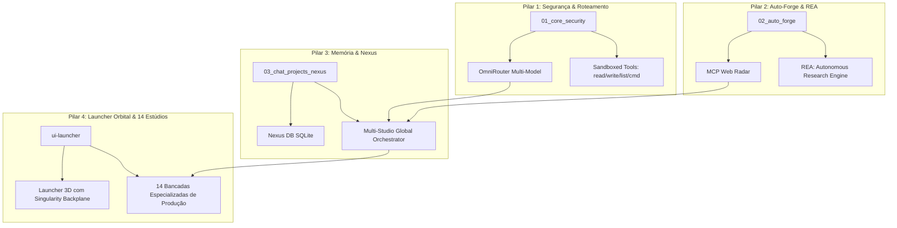

<div align="center">

# 🌑 V0ID OS
### Sovereign Autonomous Multi-Studio Operating System

[](https://www.typescriptlang.org/)
[](https://nextjs.org/)
[](file:///c:/V0id/EVOLUTION_LOG.md)
[](https://www.blender.org/)
[](file:///c:/V0id/graphify-out/)
[](./LICENSE)

<br/>

**V0id OS** é um sistema operacional autônomo soberano projetado para orquestração de múltiplos estúdios de desenvolvimento de software, jogos, mídia generativa, pesquisa avançada e automação contínua com capacidades de auto-cura (*self-healing*).

[Visual Scenes Catalog](./docs/SCENES_INDEX.md) • [Evolution Log](./EVOLUTION_LOG.md) • [Core Specification](./V0ID_SPEC.md)

</div>

---

## 🌌 Visão Geral & Arquitetura Soberana (Os 4 Pilares)

O **V0id OS** opera sobre uma fundação modular dividida em 4 pilares invioláveis:



---

## 🎨 Catálogo dos 14 Estúdios de Produção

Todas as 14 bancadas de produção contam com layouts dedicados, suporte a projetos locais isolados e captura visual automatizada:

| # | Estúdio | Identificador | Categoria | Descrição Principal | Preview |
|---|---|---|---|---|---|
| **01** | **Chat Global** | `chat` | Controle | Orquestrador Supremo com execução de pipelines multi-estúdio | [Foto](./docs/scenes/01_chat_global.png) |
| **02** | **Core Soul** | `core` | Controle | Master Blueprint (`V0ID_SPEC.md`) e parâmetros operacionais | [Foto](./docs/scenes/02_core_soul.png) |
| **03** | **Auto-Forge** | `auto-forge` | Controle | Radar de MCPs na web, REA e scanner técnico contínuo | [Foto](./docs/scenes/03_auto_forge.png) |
| **04** | **Segurança Sandbox** | `security` | Controle | Jaula Docker de teste, Semgrep SAST e bloqueio financeiro | [Foto](./docs/scenes/04_security_sandbox.png) |
| **05** | **Plugins MCP** | `plugins` | Infra | Auditoria de servidores MCP, consumo e diagnósticos | [Foto](./docs/scenes/05_plugins_mcp.png) |
| **06** | **Regras do Sistema** | `rules` | Infra | Gerenciador de modos: Caveman, Sem Censura e Anti-Ghost Write | [Foto](./docs/scenes/06_rules_system.png) |
| **07** | **Automações n8n** | `automations` | Infra | Fila de fluxos em background e robôs autônomos 24/7 | [Foto](./docs/scenes/07_automations_n8n.png) |
| **08** | **Repository Hub** | `repository` | Infra | Sincronizador de código (GitHub) e mídias brutas (Google Drive) | [Foto](./docs/scenes/08_repository_hub.png) |
| **09** | **Code Studio** | `code` | Estúdio | Editor, Prompt Improver com IA e terminal nativo | [Foto](./docs/scenes/09_code_studio.png) |
| **10** | **Game Studio Engine** | `game` | Estúdio | Viewport 2D/3D, árvore de entidades, playtest e ponte Blender | [Foto](./docs/scenes/10_game_engine.png) |
| **11** | **OmniMedia Studio** | `omnimedia` | Estúdio | Workstation com 4 bancadas: Imagem (FLUX), Áudio (F5-TTS), Vídeo e IP-Adapter | [Foto](./docs/scenes/11_omnimedia_studio.png) |
| **12** | **Research Studio** | `research` | Estúdio | Radar de papers acadêmicos, extração de texto e scores técnicos | [Foto](./docs/scenes/12_research_studio.png) |
| **13** | **Marketing Agency** | `marketing` | Negócios | Campanhas de social media, gerador de READMEs e branding | [Foto](./docs/scenes/13_marketing_agency.png) |
| **14** | **Finanças & Caixa** | `finances` | Negócios | Livro-caixa Clean Slate (saldo inicial R$ 0,00) e radar de editais | [Foto](./docs/scenes/14_finances_caixa.png) |

---

## ⚡ Loop Autônomo de Auto-Cura (Self-Healing Engine)

O V0id OS possui um mecanismo próprio de auto-manutenção que audita o sistema continuamente:

```
[1/5] Suíte de Auditoria 24 Pontos (Disco, SQLite, Inferência, Blender)
[2/5] Compilação Estrita TypeScript (0 erros em todos os 14 estúdios)
[3/5] Mapeamento Visual Inteligente (Edge Headless re-fotografa alterações de UI)
[4/5] Grafo de Conhecimento AST (Graphify Update mantendo nós e arestas sincronizados)
[5/5] Sincronização Automática com GitHub (Git commit & push origin main)
```

### Comandos do Loop:
```powershell
# Executar ciclo padrão de auditoria e auto-cura:
npm run loop

# Executar forçando captura das fotos de todos os estúdios:
npm run loop:scenes

# Executar N ciclos sequenciais com intervalo:
node v0id_autonomous_evolution_loop.mjs --cycles=3

# Executar em modo contínuo (daemon):
node v0id_autonomous_evolution_loop.mjs --loop

# Apenas capturar fotos das 15 cenas:
npm run capture

# Executar apenas a suíte de 24 pontos:
npm run test:suite
# ou no Windows:
.\v0id-autotest.bat
```

---

## 🚀 Como Iniciar o Launcher

```powershell
# 1. Instalar dependências (caso seja primeiro uso):
cd ui-launcher
npm install

# 2. Iniciar servidor Next.js na porta 3000:
npm run dev
```

Acesse **`http://localhost:3000`** no seu navegador para interagir com o **Launcher Orbital 3D** ou navegue diretamente para um estúdio via query param (ex: `http://localhost:3000/?studio=game`).

---

<div align="center">
<sub>Desenvolvido sob os princípios do Manifesto Soberano V0id OS.</sub>
</div>
